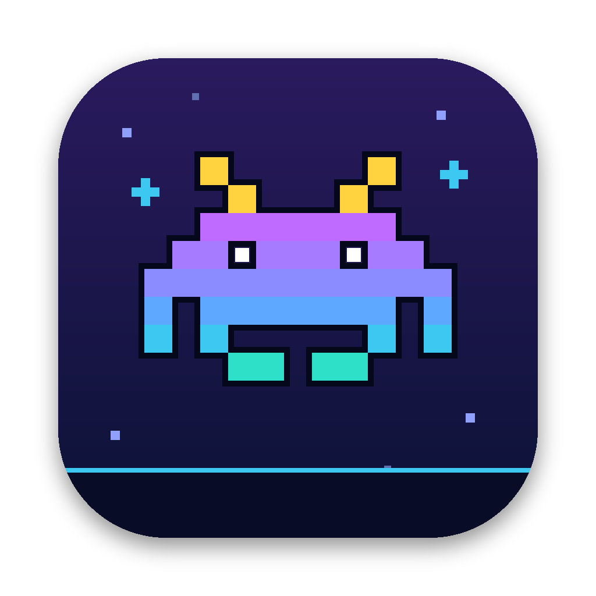
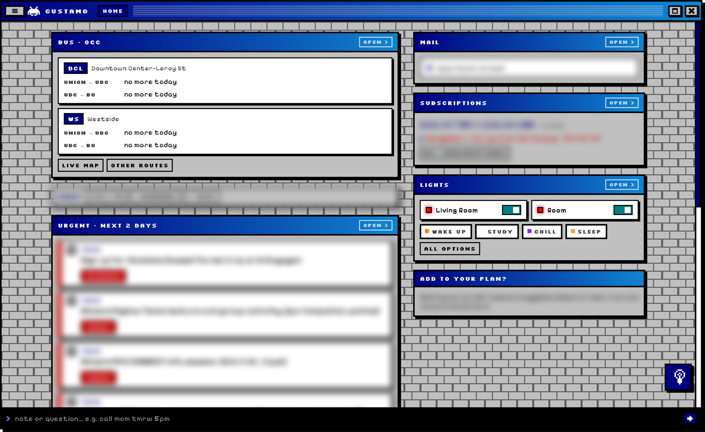
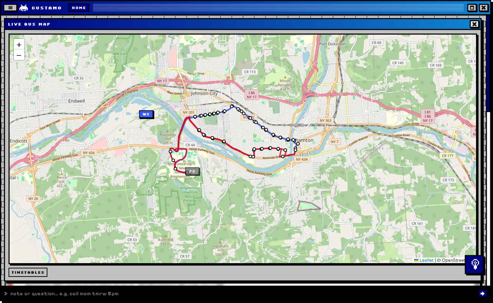
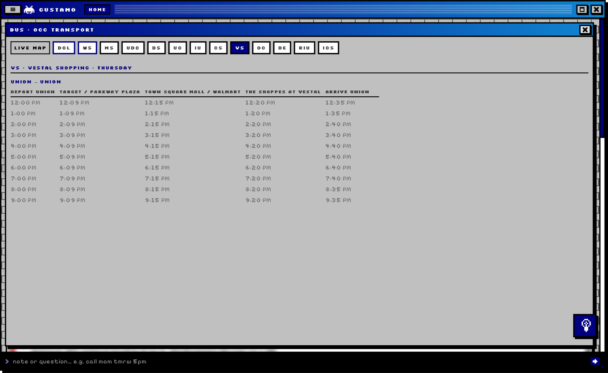
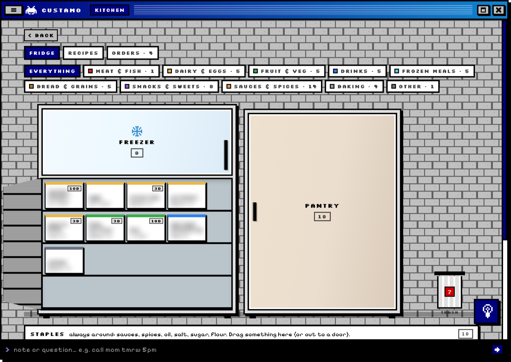
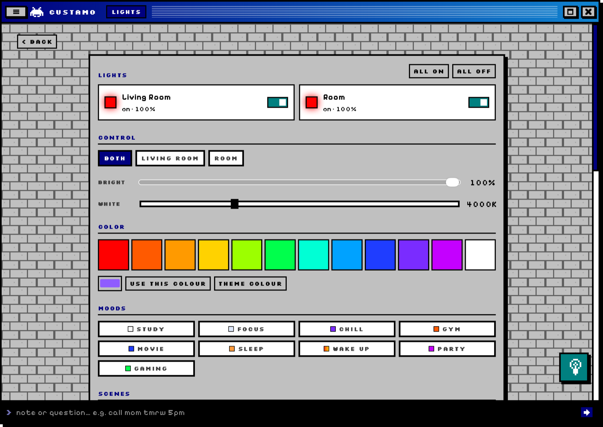
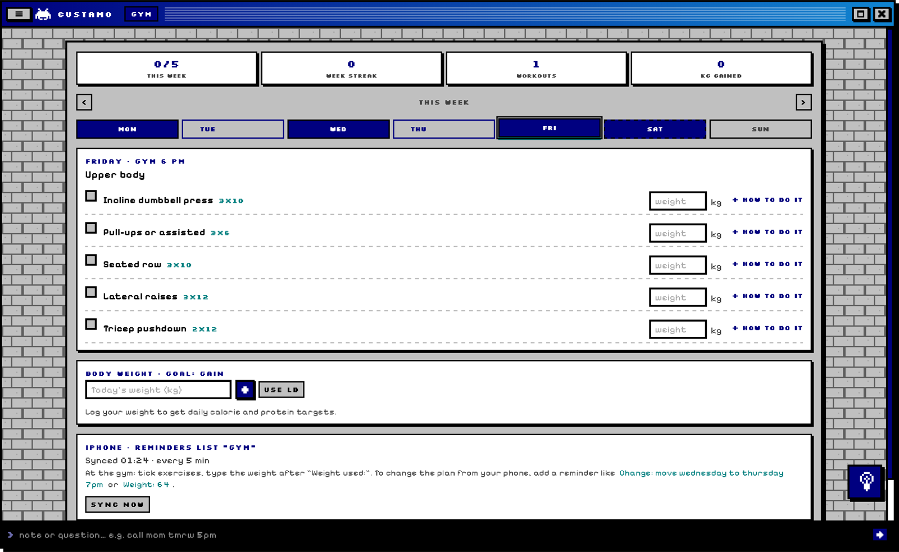
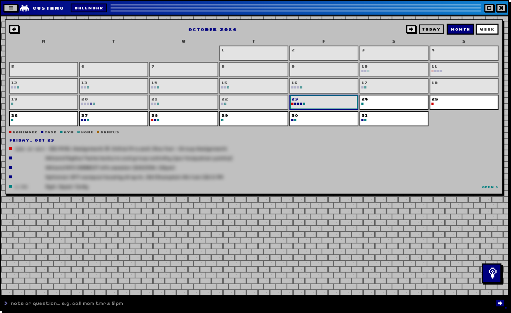

# Custamo

A personal macOS menu bar assistant with a retro pixel-art look. It lives behind a small space invader in the menu bar and opens with **Option + Space**.

> The source code is private because the app connects to my own accounts. This page shows what it does and how it is built.

## Screenshots

*Personal details (mail, tasks, deadlines, calendar events) are blurred.*

| Live bus map | Bus timetables |
|---|---|
|  |  |

| Kitchen | Lights |
|---|---|
|  |  |

| Gym | Calendar |
|---|---|
|  |  |

## What it does

- **Home summary:** today at a glance, what is due in the next two days and the week ahead.
- **Mail:** unread email from several inboxes, summarized and prioritized by an LLM, with tasks created from dates found in messages.
- **Homework:** course deadlines from the university's learning platform with countdowns; submitted work is ticked off automatically from submission receipts.
- **Tasks:** a command line that turns a plain note ("call mom tmrw 5pm") into a dated task.
- **Calendar:** month and week views combining classes, homework, tasks and workouts.
- **Kitchen:** a drawn fridge, freezer and pantry with drag-and-drop food, grocery orders read from delivery emails, shelf-life tracking, and recipes with exact gram amounts that adjust to what is in stock.
- **Gym:** a weekly workout plan with sets, weights, rest timer and progress, synced to iPhone Reminders.
- **Campus bus:** live arrival times and a live map for the university bus routes.
- **Smart lights:** colors, scenes, moods, a sleep timer and music sync for Govee lights.
- **Subscriptions:** finds subscriptions in email, totals monthly costs and warns before trials end.
- **Screen saver:** a now-playing screen with the album cover and a live audio equalizer.
- **Themes:** 15+ pixel themes and backgrounds, plus a mini game.

## Engineering angle

- **Inventory management:** the kitchen tracks stock from delivery records, with shelf life per item, first-expiring-first-out reminders and automatic removal of spoiled food, so less food is wasted.
- **Service reliability:** the bus feature compares live arrivals with the timetable and turns them into one decision: when to leave. It grew into a separate on-time performance study of the campus bus system.
- **Scheduling and planning:** deadlines from several sources are merged into one prioritised plan with alerts, and the gym plan adapts week by week.
- **Process automation:** recurring manual work (reading order emails, logging workouts, tracking subscriptions) runs on its own, with a person confirming only the decisions that matter.

## How it connects

- **The app itself:** a small web server that runs only on the Mac (`127.0.0.1:5050`), shown in a native window from the menu bar. Nothing is open to the internet, and data is stored in local JSON files with a daily backup to iCloud Drive.
- **Mail:** the official Gmail API with OAuth, read-only. Several inboxes can be connected, and logins stay on the Mac.
- **Homework:** the university learning platform's (Brightspace) personal iCalendar feed.
- **Campus buses:** timetables read from the transit agency's public route pages, plus live bus positions from its public real-time feed (ETA SPOT). The Mac's own location (Core Location) picks the closest stop.
- **Smart lights:** Govee's cloud API with a personal API key.
- **HeadRush Flex Prime (guitar amp):** over the home Wi-Fi network through the unit's built-in web API, to switch between saved rigs. It never changes settings or levels.
- **iPhone:** the gym plan syncs through Apple Reminders, and iCloud carries it to the phone.
- **Music:** reads what Spotify or Apple Music is playing through AppleScript (read-only), for the now-playing screen saver and its live equalizer.
- **AI:** the language tasks (sorting and summarizing mail, the daily brief, turning notes into tasks, reading orders and subscriptions from email, recipes) run through an LLM. All of these calls go through one module, so the AI can be switched off or replaced without touching the rest. Lights, buses, calendar, gym, the screen saver and themes work without it.

## Built with

Python and Flask (local server), pywebview and PyObjC (native macOS window, menu bar item, notifications, location), JavaScript, HTML and CSS (interface), Swift (Core Audio tap, screen saver), Gmail API, iCalendar feeds, Leaflet maps, Govee API, and an LLM for summaries, parsing and recipes. Developed with AI-assisted programming (Claude Code).

## Author

Deniz Yildiz, Industrial and Systems Engineering, Binghamton University
